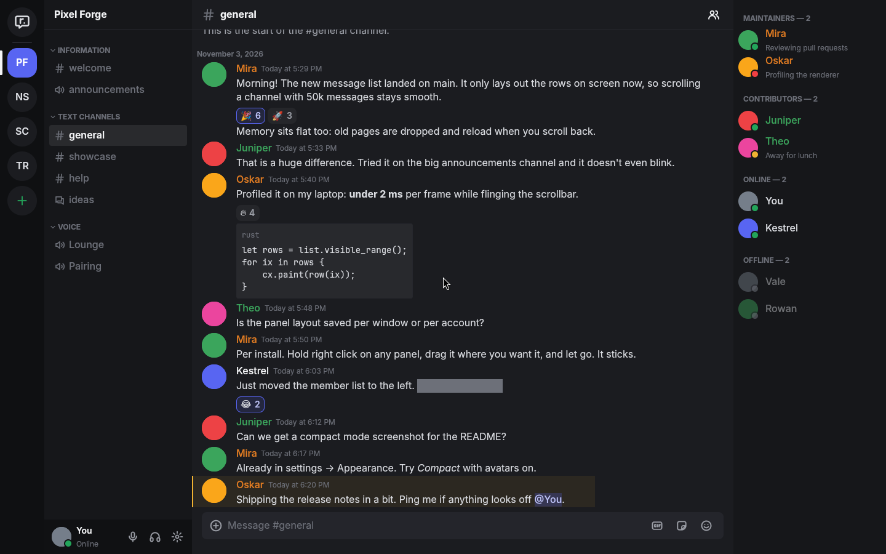

<p align="center">
  
</p>

<h1 align="center">rcord</h1>

<p align="center">
  A fast, native Discord client for Windows and Linux, written in Rust with GPUI.
</p>

<p align="center">
  <a href="https://github.com/khaodius/rcord/actions/workflows/ci.yml"></a>
  <a href="LICENSE"></a>
</p>



<p align="center"><sub>Shown with the built-in sample data (<code>RCORD_DEMO=1</code>); every name is invented.</sub></p>

## Features

- **Native and light**: one binary drawn on the GPU through Vulkan on Linux and DirectX on Windows, with no
  browser engine. Message lists and member lists only lay out the rows on screen,
  so a channel with 50,000 messages scrolls like one with 50.
- **Discord's layout, rearrangeable**: servers, channels, chat and members sit where Discord puts
  them. Hold the right mouse button on a panel, move it, and release to put it somewhere else; a
  quick right click still opens the context menu. Drag a side panel's edge to resize it, and
  double-click the edge to restore it. Drop the server list, channel list or member list on the
  target at the top, or outside the window, and it opens in a window of its own; closing that
  window or pressing **Dock** slides it back into place.
- **Messages** with Discord's full markdown: bold, italics, underline, strikethrough, spoilers,
  headings, subtext, quotes, lists, inline code and code blocks, masked links, mentions of users,
  roles and channels, `@everyone`, slash command mentions and timestamps in every style. Replies,
  attachments, link embeds and system messages are drawn the way Discord draws them, grouped by
  author like Discord groups them.
- **Emoji, stickers and GIFs**: custom and animated emoji, jumbo emoji, reactions (click to add or
  remove yours), a picker with Unicode and server emoji, server and standard stickers, and a GIF
  search with trending categories.
- **Profiles**: banners, profile theme colors, avatar decorations, every badge Discord shows,
  server tags, pronouns, the bio with markdown, member-since dates, roles, connections and mutual
  servers. Server profiles override global ones as they do in Discord.
- **Presence**: online, idle, do-not-disturb and invisible, custom statuses and activities, and
  typing indicators.
- **Friends** on Home: online friends with their status or activity, all friends, pending
  requests to accept or ignore, blocked users, adding a friend by username, and an Active Now
  column with the games, music and voice channels your friends are in.
- **Unread state** synced with your other devices: unread channels, mention counts on channels and
  servers, mark as read, and jumping between unread channels from the keyboard.
- **Quick switcher** (Ctrl + K) across every server and DM, unread ones first.
- **Sign in** like Discord's login screen: email or phone number and password with two-factor
  codes (authenticator app, SMS or backup code), a QR code for the Discord mobile app, or
  Discord's own sign-in page. When Discord asks for a captcha, it opens in a small Discord
  window and the sign-in carries on. The token is kept in the system keychain (Windows
  Credential Manager, or the Secret Service of GNOME Keyring or KWallet), never in a file.
- **Settings** for everything Discord has and more for the look of the app: four themes including
  an OLED black, any accent color, interface zoom, chat font size, cozy or compact messages, group
  spacing, corner roundness, saturation, interface and code fonts picked from the fonts installed
  on your computer, a live preview of messages as you change them, role color style, animation
  rules for emoji and avatars, reduced motion, link underlines, role color contrast, streamer mode,
  privacy, notifications, voice and screen share preferences, language, cache sizes and developer
  mode. Every change applies immediately and is saved as plain TOML.
- **Custom themes**: start from a built-in theme and change any of 25 colors, both corner radii
  and both fonts in Settings, or by hand in a TOML file. Export a theme to share it, import one
  someone else made, or drop theme files in the themes folder. [docs/THEMES.md](docs/THEMES.md)
  describes every key.
- **Updates** at start: when a newer release is out, rcord asks, then installs it in the
  background without installer screens and restarts. It can be turned off in Settings.
- **Rebindable shortcuts** for every action, recorded by pressing the keys.
- **Resilient connection**: zlib-compressed gateway, session resume after a drop, reconnects with
  backoff, heartbeat timeouts detected, and Discord's rate limits followed per route.
- **Image cache** on disk for Discord's CDN, keyed by URL, so avatars, emoji and attachments seen
  once load instantly afterwards. Decoded images in memory are capped and evicted oldest first,
  only the last few channels keep their history in memory, and freed memory goes back to the
  system instead of sitting in the heap.

- **Voice channels and calls**: Opus audio at the channel's bitrate, Discord's end-to-end
  encryption (DAVE) with the call's privacy code, noise suppression (RNNoise), voice activity
  that adapts to the room or follows a fixed threshold, a jitter buffer per speaker with
  forward error correction for lost packets, and speaking rings in the channel list.

- **Video player**: MP4 and MOV videos in chat play inside rcord, with H.264 decoded by
  OpenH264 and AAC sound by Symphonia, a seek bar, volume and keyboard controls.
- **Window**: an optional slim title bar with minimize, maximize and close for desktops that
  draw none, close to tray on Linux and Windows, servers in your own order, and a Home button
  that shows the logo, the friends icon, your avatar or your own picture.

Screen share is not available yet; see the [roadmap](#roadmap).

## Install

Windows, in PowerShell:

```powershell
irm https://raw.githubusercontent.com/khaodius/rcord/main/scripts/install.ps1 | iex
```

Windows, in Command Prompt:

```bat
curl -fsSL https://raw.githubusercontent.com/khaodius/rcord/main/scripts/install.cmd -o install.cmd && install.cmd && del install.cmd
```

Linux:

```sh
curl -fsSL https://raw.githubusercontent.com/khaodius/rcord/main/scripts/install.sh | bash
```

Each command downloads the latest release, checks it against the release's `SHA256SUMS.txt` and
installs it:

- **Windows**: the setup program runs silently and installs rcord for the current user in
  `%LOCALAPPDATA%\Programs\rcord`, with a Start menu shortcut and no admin prompt. A running copy
  is closed first, and an installed one is upgraded with its settings kept.
- **Linux**: the `.deb` through apt on Debian and Ubuntu, or the `.rpm` through dnf, zypper or
  yum on Fedora, RHEL and openSUSE, both with sudo. Any other distribution gets the binary in
  `~/.local/bin` with an applications menu entry, and `--user` picks that on any distribution,
  for your user only and without root.

A version number installs that release instead:

```sh
curl -fsSL https://raw.githubusercontent.com/khaodius/rcord/main/scripts/install.sh | bash -s -- 0.1.0
```

```powershell
& ([scriptblock]::Create((irm https://raw.githubusercontent.com/khaodius/rcord/main/scripts/install.ps1))) 0.1.0
```

```bat
curl -fsSL https://raw.githubusercontent.com/khaodius/rcord/main/scripts/install.cmd -o install.cmd && install.cmd 0.1.0 && del install.cmd
```

The scripts are in [`scripts/`](scripts) to read before running. To remove rcord, use Installed
apps in Windows Settings, `sudo apt remove rcord` or `sudo dnf remove rcord`, or delete
`~/.local/bin/rcord`, `~/.local/bin/rcord-webview` and `~/.local/share/applications/rcord.desktop`.

Or download a package from the [latest release](https://github.com/khaodius/rcord/releases/latest):

| Platform | Packages                                      |
| -------- | --------------------------------------------- |
| Windows  | `-setup.exe` (recommended) or portable `.zip` |
| Linux    | `.deb`, `.rpm` or `.tar.gz`                   |

Changes are listed in the [changelog](CHANGELOG.md).

### Verifying a download

Every release includes `SHA256SUMS.txt` and a signed build provenance attestation for each file.

```sh
# Linux, in the download folder
sha256sum --check --ignore-missing SHA256SUMS.txt

# Windows (PowerShell), compare the output with SHA256SUMS.txt
Get-FileHash <file> -Algorithm SHA256

# Provenance, with the GitHub CLI
gh attestation verify <file> --repo khaodius/rcord
```

The Windows builds are not code-signed yet, so SmartScreen may warn about an unknown publisher.

## Notes

- **Unofficial**: rcord is not made by, affiliated with or endorsed by Discord. Discord's Terms
  of Service do not allow third-party clients, and an account that uses one can be limited or
  suspended. You use rcord at your own risk.
- **Data** is stored in `~/.config/rcord/` on Linux and `%APPDATA%\khaodius\rcord\config\` on
  Windows: `settings.toml` holds every setting and the ID of the last account, never its token.
  Cached images are in `~/.cache/rcord/images/` and `%LOCALAPPDATA%\khaodius\rcord\cache\images\`,
  trimmed to the size set in Settings > Advanced at each start.
- **Keychain on Linux**: the token is stored through the Secret Service API, which GNOME Keyring
  and KWallet provide. Without either, rcord still signs in but asks again at the next start.
- **Captcha window**: the captcha and Discord's own sign-in page open in `rcord-webview`, a
  small window that uses the system's web engine: WebView2 on Windows, which Windows 10 and 11
  include, and WebKitGTK on Linux, which the .deb and .rpm install.
- **Graphics**: Linux needs a Vulkan driver (Mesa's is included with most distributions). rcord
  runs on Wayland and X11 and picks whichever the session uses.
- **Client version**: Discord updates its web client several times a day. rcord reads the
  current build number from Discord's web app at each start and sends it from the next start
  on; Settings > Advanced can pin a number instead.
- **Logs** go to the terminal; `RCORD_LOG=debug rcord` shows more. Tokens are never logged.
- **Sample data**: `RCORD_DEMO=1 rcord` opens with invented servers and messages and no network
  connection, to try the interface without an account.

## Keyboard shortcuts

Every shortcut can be changed in Settings > Keybinds.

| Keys                          | Action                       |
| ----------------------------- | ---------------------------- |
| Ctrl + K                      | Quick switcher               |
| Alt + Up, Alt + Down          | Previous, next channel       |
| Alt + Shift + Up, Down        | Previous, next unread        |
| Ctrl + Alt + Up, Down         | Previous, next server        |
| Esc                           | Mark channel read, or close  |
| Ctrl + U                      | Show or hide the member list |
| Ctrl + Shift + M              | Mute                         |
| Ctrl + Shift + D              | Deafen                       |
| Ctrl + =, Ctrl + -, Ctrl + 0  | Zoom in, out, reset          |
| Ctrl + Alt + Shift + L        | Reset the panel layout       |
| Ctrl + ,                      | Settings                     |
| Hold right click on a panel   | Move the panel               |
| Enter                         | Send                         |

## Roadmap

- **Voice**: push to talk with a global key, echo cancellation, per-user volume in the
  participant menu, and an input level meter in Settings.
- **Screen share (Go Live)** and camera video with hardware encoding where available, and
  more video formats in the player (WebM, HEVC).
- **Composer**: multi-line messages, editing your last message with Up, file uploads, emoji and
  mention autocomplete.
- **Threads and forums** as their own views, pinned messages, and message search.
- **Desktop notifications**, following the settings that are already in place.

[ARCHITECTURE.md](docs/ARCHITECTURE.md) explains how the pieces fit together.

## Build from source

Requires [Rust](https://rustup.rs) 1.88+. On Linux, also the development packages for
xkbcommon, Wayland, X11, fontconfig, Vulkan, WebKitGTK (for the captcha window) and ALSA, plus
CMake, which builds the bundled Opus codec:

```sh
# Debian, Ubuntu
sudo apt install pkg-config libxkbcommon-dev libxkbcommon-x11-dev libwayland-dev libx11-xcb-dev \
  libxcb1-dev libfontconfig-dev libfreetype-dev libvulkan-dev libwebkit2gtk-4.1-dev \
  libasound2-dev cmake
# Fedora
sudo dnf install pkg-config libxkbcommon-devel libxkbcommon-x11-devel wayland-devel \
  libxcb-devel fontconfig-devel freetype-devel vulkan-loader-devel webkit2gtk4.1-devel \
  alsa-lib-devel cmake
```

```sh
git clone https://github.com/khaodius/rcord.git
cd rcord
cargo run                      # debug build
cargo build --release          # optimized build in target/release
```

## Development

CI runs these checks on Linux and Windows:

```sh
cargo fmt --all --check
cargo clippy --workspace --all-targets -- -D warnings
cargo test --workspace
```

The workspace is split so most of the client is tested without a window:

| Crate                                     | Purpose                                                     |
| ----------------------------------------- | ----------------------------------------------------------- |
| [`rcord`](crates/rcord)                   | The application: views, state, settings screen              |
| [`rcord-media`](crates/rcord-media)       | MP4 playback: H.264 and AAC decoding, sound out             |
| [`rcord-model`](crates/rcord-model)       | Discord's objects, permissions and CDN URLs                 |
| [`rcord-gateway`](crates/rcord-gateway)   | The gateway connection: compression, heartbeat, resume      |
| [`rcord-rest`](crates/rcord-rest)         | The HTTP API with per-route rate limits                     |
| [`rcord-store`](crates/rcord-store)       | The cache that gateway events and API pages are applied to  |
| [`rcord-markup`](crates/rcord-markup)     | The markdown parser                                         |
| [`rcord-auth`](crates/rcord-auth)         | Password, two-factor and QR sign-in, keychain storage       |
| [`rcord-settings`](crates/rcord-settings) | Settings, defaults and the TOML file                        |
| [`rcord-voice`](crates/rcord-voice)       | Voice gateway, DAVE, RTP transport and the audio path       |
| [`rcord-webview`](crates/rcord-webview)   | The small Discord window for captchas and web sign-in       |

`third_party/xattr` is xattr 0.2.3 with one constant changed so it builds against current libc on
Linux; [its README](third_party/xattr/README.md) explains why.

To release, set the new version in `[workspace.package]` of `Cargo.toml`, run `cargo check` to
update `Cargo.lock`, add a section to [CHANGELOG.md](CHANGELOG.md) and merge to `main`. The
release workflow builds, tags and publishes it.

## License

[Apache License 2.0](LICENSE). The bundled Inter and JetBrains Mono fonts keep their own
licenses, listed in [assets/fonts](assets/fonts/README.md). The video player compiles
Cisco's OpenH264 (BSD-2-Clause) from source.
